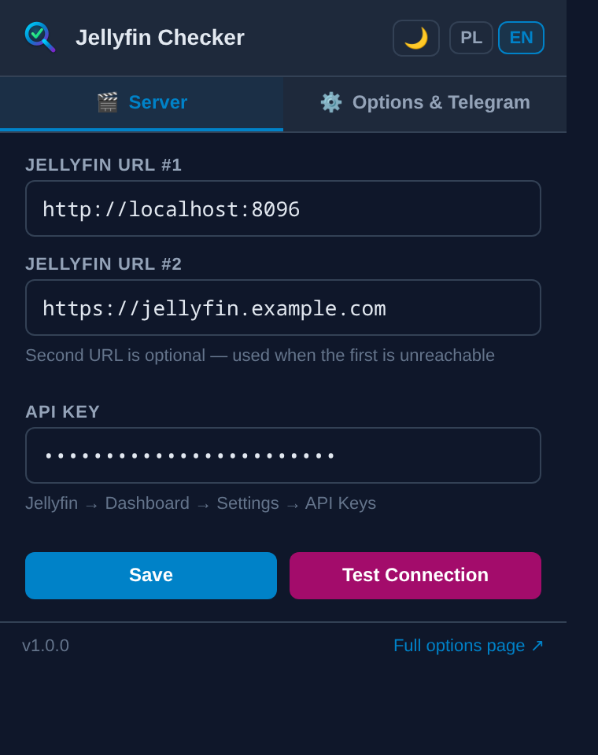
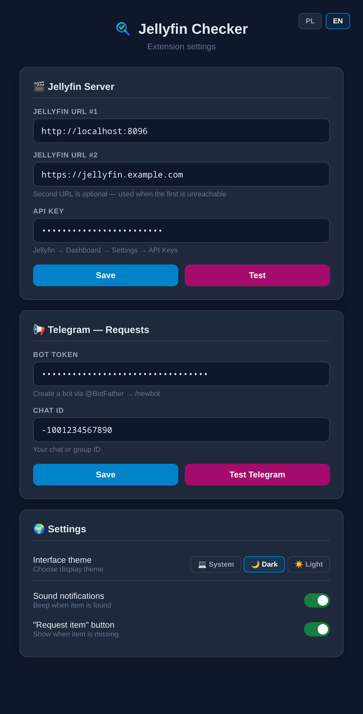
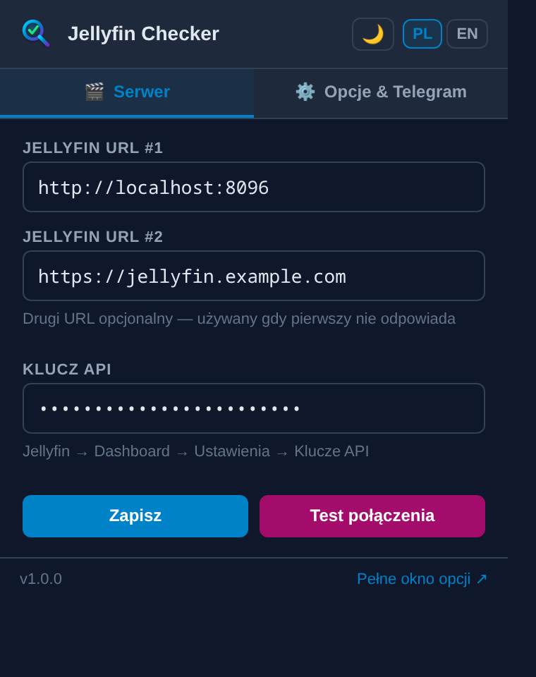
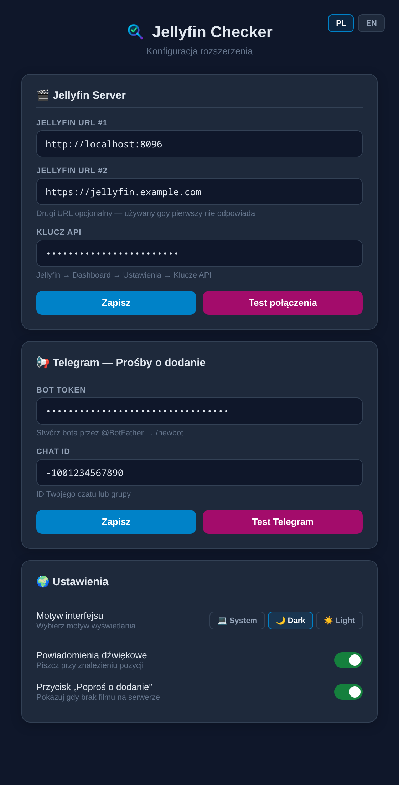

# Jellyfin Checker

> 🛠️ **Hobby project**  
> *EN:* Check in real time if movies, TV series, or people are available on your Jellyfin server while browsing **Filmweb**, **IMDb**, or **TMDb**.  
> *PL:* Sprawdź w czasie rzeczywistym, czy film, serial lub osoba znajduje się na Twoim serwerze Jellyfin podczas przeglądania **Filmwebu**, **IMDb** lub **TMDb**.

[ 🇬🇧 English ](#-english) • [ 🇵🇱 Polski ](#-polski)


[](https://chromewebstore.google.com/detail/jellyfin-checker/llbfpbeiiidailfdcbdeilmonlikdoef)
[](https://addons.mozilla.org/addon/jellyfin-checker/)

---

## 🇬🇧 English

A browser extension that checks in real time whether movies, TV shows, or people are available in your Jellyfin library while browsing **Filmweb**, **IMDb**, or **The Movie Database (TMDb)**.

### Features

- **Automatic detection** — recognizes movie, series, season, episode, and person pages automatically
- **Multiple sites** — works on Filmweb, IMDb (desktop & mobile), and TMDb
- **Season & episode support** — visiting a season or episode subpage automatically checks your library for the parent TV series
- **Smart matching** — separates movies from series, validates IMDb/TMDb IDs, handles subtitles (`:` / `-`), and falls back to original titles and fuzzy matching
- **Dual server URLs** — configure a primary and fallback URL (e.g. local LAN IP + remote domain)
- **All-in-one popup** — configure your server, toggle sound effects, and set up Telegram requests directly from the toolbar popup (settings autosave as you type)
- **Theme switcher** — System, Dark, and Light themes
- **Telegram requests** — optional **"Request item"** button lets household members request missing titles with one click
- **Bilingual UI** — English and Polish interface
- **Tampermonkey / Violentmonkey userscripts** — standalone userscripts available in [`userscripts/`](userscripts/README.md) (including the reverse **Jellyfin → Filmweb** button)

### How it works

1. Open a movie, series, season, episode, or person page on **Filmweb**, **IMDb**, or **TMDb**.
2. The extension queries your Jellyfin server via its API.
3. A status badge appears in the top-right corner of the page — click a found title to open it directly in Jellyfin.


#### Badge states

| State | Meaning |
| :--- | :--- |
| ✅ **Found** | Item is available in your Jellyfin library — click the badge to open it |
| ✅ **Found (person page)** | Shows how many items associated with this person are in your library |
| ❌ **Not found** | No matching item found in your Jellyfin library (shows the optional Telegram request button) |
| 🔍 **Searching** | Query in progress |
| ⚠️ **Connection error** | Could not reach the Jellyfin server or invalid API key |

#### Screenshots

| Popup | Full Options |
| :---: | :---: |
|  |  |

### Installation

#### Chrome / Brave / Edge
Install directly from the **[Chrome Web Store](https://chromewebstore.google.com/detail/jellyfin-checker/llbfpbeiiidailfdcbdeilmonlikdoef)**.

#### Firefox
Install directly from **[Firefox Add-ons (AMO)](https://addons.mozilla.org/addon/jellyfin-checker/)**.

#### Manual installation (Developer mode)

1. Clone this repository and build the packages:
   ```bash
   git clone https://github.com/patientone-io/jellyfin-checker.git
   cd jellyfin-checker
   bash build.sh all
   ```
2. Load the extension in your browser:
   - **Chrome / Brave / Edge:** open `chrome://extensions` (or `brave://extensions` / `edge://extensions`), enable **Developer mode**, click **Load unpacked**, and select `dist/chrome`.
   - **Firefox:** open `about:debugging#/runtime/this-firefox`, click **Load Temporary Add-on**, and select `dist/firefox/manifest.json` (temporary add-ons are removed when Firefox restarts; see [Mozilla's guide](https://extensionworkshop.com/documentation/develop/temporary-installation-in-firefox/)).

> **Note:** If you also use Tampermonkey/Violentmonkey, install only one Checker variant (either the browser extension or `jellyfin-checker.user.js`) to avoid duplicate badges on the page.

### Configuration

Click the **Jellyfin Checker** icon in your browser toolbar:

1. **Jellyfin URL #1** — enter your server root URL (e.g. `http://192.168.1.100:8096`), without `/web/`, query parameters, or `#`.
   - Optionally add **Jellyfin URL #2** as a fallback address for the same server (e.g. your external domain or Tailscale/VPN address).
2. **API Key** — generate a key in Jellyfin under **Dashboard → Settings → API Keys → +**.
3. Click **Test Connection** — a green banner will confirm the server name and Jellyfin version.

Settings save automatically as you type. Reload any already-open film tabs after changing your configuration.

#### Telegram requests (optional)

When a movie or series is missing from your Jellyfin library, the extension can display a **Request** button right below the badge. Clicking it sends a notification to Telegram with the title, release year, and page link. This is great for household members who want to ask the server admin to add a movie with one click, or as a personal watchlist (person pages do not show this button).

1. Open [@BotFather](https://t.me/BotFather) in Telegram, send `/newbot`, and follow the prompts (choose any display name, then a username ending in `bot`).
2. Copy the **HTTP API token** returned by BotFather (looks like `123456789:AAHfiqksKZ8WmR2z...`).
3. Open a chat with your newly created bot in Telegram and click **Start** at the bottom (or add the bot to your group). *Important: Telegram bots cannot send you messages until you start a conversation with them first.*
4. Find your **Chat ID**:
   - **For direct messages:** send any message to [@userinfobot](https://t.me/userinfobot) — it replies with your numeric `Id` (e.g. `123456789`).
   - **For a group:** send a message in the group after adding the bot, then open `https://api.telegram.org/bot<YOUR_TOKEN>/getUpdates` in your browser (replace `<YOUR_TOKEN>` with your bot token) and copy the number from `"chat":{"id":-100...}` (including the leading minus sign).
5. Click the Jellyfin Checker icon in your browser and switch to the **Options & Telegram** tab.
6. Enable the **"Request item" button** toggle, paste your **Telegram Bot Token** and **Telegram Chat ID**, and click **Test Telegram**. You will receive a test message in Telegram.

In the same tab, you can also enable **Sound Notifications** (a short beep when an item is found), or use the buttons in the top-right corner of the popup to switch the **theme** (System / Dark / Light) and **language** (EN / PL).

### Supported pages & search strategy

| Site | Supported pages | Metadata extracted |
| :--- | :--- | :--- |
| **Filmweb** | Movies (`/film/*`), Series (`/serial/*`), Seasons (`/serial/*/season/*`), Episodes (`/serial/*/episode/*/*`), People (`/person/*`) | Filmweb `/info` API + DOM & LD+JSON (Polish title, original title, year, parent series) |
| **IMDb** | Movies & Series (`/title/tt*`), Season/Episode lists (`/title/tt*/episodes*`), Single episodes, People (`/name/nm*`), Mobile (`m.imdb.com`) | IMDb ID (`tt*`), LD+JSON, `__NEXT_DATA__`, DOM series links & `og:title` |
| **TMDb** | Movies (`/movie/*`), TV Series (`/tv/*`), Seasons (`/tv/*/season/*`), Episodes (`/tv/*/season/*/episode/*`), People (`/person/*`) | TMDb numeric ID, media type, title, release year, parent series |

#### How matching works

1. **Media type filtering** — queries up to 30 candidates from Jellyfin filtered by type (`Movie` vs `Series`), preventing movies from matching TV shows of the same name.
2. **Provider ID verification** — prefers an exact IMDb or TMDb ID match among candidates and immediately rejects any candidate with a conflicting IMDb/TMDb ID.
3. **Title & subtitle matching** — compares normalized titles and original titles, including subtitle splitting (`:` / `-`) so e.g. *We Can Be Heroes* matches *We Can Be Heroes: Finding The Australian of the Year* while still rejecting numbered sequels (*Part 2*, *II*, etc.) and short unrelated prefixes.
4. **Year tolerance** — allows up to 2 years of difference when provider IDs are unavailable on one side.
5. **Original title fallback** — if the localized title returns no match, performs a second search using the original title.
6. **Seasons & episodes** — season and episode subpages check whether the parent TV series exists in your library (they do not verify individual episode files).

### Component versions & What's new in v1.0.4

| Component | Version | Description |
| :--- | :--- | :--- |
| **Browser extension** (`chrome/` & `firefox/`) | `1.0.4` | Main extension for Chrome, Brave, Edge, and Firefox |
| [`userscripts/jellyfin-checker.user.js`](userscripts/README.md) | `1.0.4` | Standalone Tampermonkey/Violentmonkey equivalent of the extension |
| [`userscripts/jellyfin-to-filmweb.user.js`](userscripts/README.md) | `1.4.1` | Reverse integration: adds a direct **Filmweb** button inside the Jellyfin Web UI |

**Highlights in v1.0.4:**
- **Full season & episode support across Filmweb, IMDb, and TMDb** — episode pages on Filmweb (`/episode/S/E`), episode lists and single episodes on IMDb, and season/episode subpages on TMDb now resolve and check the parent series.
- **Stricter & smarter matching** — `IncludeItemTypes` (`Movie` / `Series`) filtering, conflicting IMDb/TMDb ID rejection, and colon/dash subtitle support.
- **Jellyfin 10.11+ connection test fix** — sends the full `Authorization: MediaBrowser ... Token="..."` header alongside `X-Emby-Token` on `/System/Info`.
- **Serialized settings autosave** — shared `src/settings.js` module and background write queue prevent race conditions during rapid popup/options edits.
- **Jellyfin to Filmweb Linker v1.4.1** — parent `SeriesId` resolution for seasons/episodes, stricter title/year verification, request deduplication, and SPA cleanup.

### Troubleshooting

| Problem | What to check |
| :--- | :--- |
| **⚠️ Connection error** | Click **Test Connection** in the popup. Make sure the URL points to the server root (or configured base path) without `/web/`, and verify your API key. |
| **Movie is in Jellyfin, but shows ❌ Not found** | Check the item's title, original title, release year, and IMDb/TMDb IDs in Jellyfin's metadata editor. |
| **No badge appears on the page** | Make sure you are on a movie, series, season, episode, or person card (news, rankings, and forum discussions are ignored) and reload the tab. |
| **Telegram test fails** | Check your Bot Token and Chat ID, and make sure you clicked **Start** in a chat with your bot (or added it to the target group). |

<details>
<summary><strong>🔒 Privacy, permissions & pre-configuring for family</strong></summary>

- **Local storage only:** API keys and settings are stored locally in `chrome.storage.local`.
- **Zero telemetry:** No analytics or tracking data is ever sent to the developer. The extension only communicates with your configured Jellyfin server, Filmweb's metadata API (when on Filmweb), and Telegram (only when you click Request or Test).
- **Why does the extension ask for access to all websites (`*://*/*`)?** Your Jellyfin server can live on any local IP (`192.168.x.x`), custom port, or personal domain. Because that address isn't known at build time, the extension requires broad host permissions to connect to your server.
- **Firefox data consent:** Firefox 142+ displays a standard installation notice covering authentication information, website content, and browsing activity for these connections. See [Mozilla's documentation](https://extensionworkshop.com/documentation/develop/firefox-builtin-data-consent/).
- **Pre-filling `src/config.json` for household members:** Before running `bash build.sh all` for a fresh installation, you can fill in your server URL, API key, and Telegram details in `src/config.json`. It is loaded on first install (updates keep existing user settings). *Warning: keep custom builds with embedded keys private, as `config.json` is stored in plain text.*

</details>

<details>
<summary><strong>🛠️ Project structure & running tests</strong></summary>

```text
jellyfin-checker/
├── src/                # Shared extension source files
│   ├── background.js   # Service worker - Jellyfin & Telegram API logic
│   ├── content.js      # Page metadata extraction & status badge UI
│   ├── settings.js     # Shared settings sanitization & normalization
│   ├── popup.html/js   # Toolbar popup UI & logic
│   ├── options.html/js # Full options page UI & logic
│   ├── config.json     # Default config template (no secrets)
│   └── screenshots/    # Documentation screenshots
├── chrome/             # Chrome/Brave/Edge Manifest V3
├── firefox/            # Firefox Manifest V3 (Gecko 142+)
├── userscripts/        # Standalone Tampermonkey/Violentmonkey scripts
├── tests/              # Unit, regression & Playwright browser smoke tests
└── build.sh            # Build script (bash build.sh all)
```

Unit and regression tests require **Node.js 22+** (zero npm dependencies needed):

```bash
node --test tests/*.test.cjs
bash build.sh all
```

To run the automated Chromium smoke tests with Playwright:

```bash
npm ci
npx playwright install chromium
npm run build
npm run test:browser
```

</details>

---

## 🇵🇱 Polski

Rozszerzenie przeglądarki, które w czasie rzeczywistym sprawdza, czy przeglądany film, serial lub osoba znajduje się w Twojej bibliotece Jellyfin — bezpośrednio na stronach **Filmweb**, **IMDb** oraz **The Movie Database (TMDb)**.

### Główne funkcje

- **Automatyczne wykrywanie** — bez klikania rozpoznaje strony filmów, seriali, sezonów, odcinków oraz osób
- **Wiele serwisów** — działa na Filmwebie, IMDb (również mobilnym) oraz TMDb
- **Obsługa sezonów i odcinków** — wejście na podstronę sezonu lub konkretnego odcinka automatycznie sprawdza dostępność serialu nadrzędnego w Jellyfinie
- **Trafne dopasowywanie** — rozróżnia filmy od seriali, weryfikuje identyfikatory IMDb/TMDb, obsługuje podtytuły po dwukropku i myślniku (`:` / `-`), a w razie potrzeby sprawdza tytuł oryginalny i dopasowanie przybliżone (Levenshtein)
- **Dwa adresy serwera** — możliwość wpisania głównego i zapasowego adresu Jellyfina (np. lokalne IP w sieci domowej + zewnętrzna domena / VPN)
- **Wszystko pod ręką w popupie** — konfiguracja serwera, dźwięków i Telegrama od razu po kliknięciu ikony na pasku przeglądarki (ustawienia zapisują się automatycznie podczas pisania)
- **Wybór motywu** — motyw Systemowy, Ciemny i Jasny
- **Prośby przez Telegrama** — opcjonalny przycisk **„Poproś o dodanie”** pozwala domownikom jednym kliknięciem wysłać prośbę o brakujący film lub serial
- **Dwujęzyczny interfejs** — pełna obsługa języka polskiego i angielskiego
- **Skrypty Tampermonkey / Violentmonkey** — w katalogu [`userscripts/`](userscripts/README.md) znajdziesz wersję skryptową oraz dodatkowy skrypt **Jellyfin → Filmweb** (dodający przycisk Filmwebu bezpośrednio w interfejsie Jellyfina)

### Jak to działa?

1. Wejdź na kartę filmu, serialu, sezonu, odcinka lub osoby na **Filmwebie**, **IMDb** lub **TMDb**.
2. Rozszerzenie w tle odpytuje Twój serwer Jellyfin przez API.
3. W prawym górnym rogu strony pojawia się plakietka (badge) z wynikiem — kliknij znalezioną pozycję, aby od razu otworzyć ją w Jellyfinie.


#### Stany badge'a

| Stan | Znaczenie |
| :--- | :--- |
| ✅ **Znaleziono** | Pozycja jest w bibliotece Jellyfin — kliknij, aby przejść do filmu lub serialu |
| ✅ **Znaleziono (strona osoby)** | Pokazuje liczbę filmów i seriali z tą osobą dostępnych w Twojej bibliotece |
| ❌ **Nie znaleziono** | Brak pozycji w bibliotece Jellyfin (wyświetla opcjonalny przycisk prośby przez Telegrama) |
| 🔍 **Szukam** | Trwa sprawdzanie w bibliotece |
| ⚠️ **Błąd połączenia** | Nie udało się połączyć z serwerem Jellyfin lub klucz API jest nieprawidłowy |

#### Zrzuty ekranu

| Popup | Pełne opcje |
| :---: | :---: |
|  |  |

### Instalacja

#### Chrome / Brave / Edge
Zainstaluj bezpośrednio z **[Chrome Web Store](https://chromewebstore.google.com/detail/jellyfin-checker/llbfpbeiiidailfdcbdeilmonlikdoef)**.

#### Firefox
Zainstaluj bezpośrednio z **[Firefox Add-ons (AMO)](https://addons.mozilla.org/addon/jellyfin-checker/)**.

#### Instalacja ręczna (Tryb deweloperski)

1. Sklonuj repozytorium i zbuduj paczki:
   ```bash
   git clone https://github.com/patientone-io/jellyfin-checker.git
   cd jellyfin-checker
   bash build.sh all
   ```
2. Wczytaj rozszerzenie w przeglądarce:
   - **Chrome / Brave / Edge:** otwórz stronę rozszerzeń (`chrome://extensions`, `brave://extensions` lub `edge://extensions`), włącz **Tryb programisty**, kliknij **Wczytaj rozpakowane** i wskaż katalog `dist/chrome`.
   - **Firefox:** otwórz `about:debugging#/runtime/this-firefox`, kliknij **Wczytaj tymczasowy dodatek** i wskaż plik `dist/firefox/manifest.json` (dodatek tymczasowy działa do zamknięcia Firefoksa — zobacz [instrukcję Mozilli](https://extensionworkshop.com/documentation/develop/temporary-installation-in-firefox/)).

> **Wskazówka:** Jeśli korzystasz również z Tampermonkey/Violentmonkey, używaj tylko jednego wariantu Checkera (albo rozszerzenia, albo skryptu `jellyfin-checker.user.js`), aby na stronie nie wyświetlały się dwa podwójne statusy.

### Konfiguracja

Kliknij ikonę **Jellyfin Checker** na pasku przeglądarki:

1. **Jellyfin URL #1** — wpisz główny adres swojego serwera (np. `http://192.168.1.100:8096`), bez końcówki `/web/`, parametrów zapytania ani `#`.
   - Opcjonalnie uzupełnij **Jellyfin URL #2** jako zapasowy adres tego samego serwera (np. zewnętrzna domena lub adres VPN/Tailscale).
2. **Klucz API** — wygeneruj w panelu administratora Jellyfina: **Panel administracyjny (Dashboard) → Ustawienia → Klucze API → +**.
3. Kliknij **Test połączenia** — zielony komunikat potwierdzi nazwę i wersję Twojego serwera.

Ustawienia zapisują się automatycznie podczas pisania. Po zmianie konfiguracji odśwież otwarte wcześniej karty z filmami.

#### Prośby przez Telegrama (opcjonalnie)

Gdy filmu lub serialu nie ma w Twojej bibliotece Jellyfin, rozszerzenie może wyświetlić pod statusem przycisk **Poproś o dodanie**. Kliknięcie go wysyła powiadomienie na Telegrama z tytułem, rokiem premiery i linkiem do przeglądanej strony. Przydaje się to, gdy dzielisz serwer z domownikami (mogą jednym kliknięciem poprosić Cię o dodanie tytułu) albo chcesz prowadzić własną listę pozycji do pobrania (na kartach osób przycisk się nie pojawia).

1. Otwórz w Telegramie czat z [@BotFather](https://t.me/BotFather), wyślij wiadomość `/newbot` i postępuj zgodnie z instrukcją (podaj dowolną nazwę wyświetlaną bota, a potem nazwę użytkownika kończącą się na `bot`).
2. Skopiuj wygenerowany klucz **HTTP API token** (wygląda np. tak: `123456789:AAHfiqksKZ8WmR2z...`).
3. Otwórz utworzonego bota w Telegramie i kliknij **Start** na dole ekranu (albo dodaj bota do wybranej grupy). *Ważne: bez tego kroku bot w Telegramie nie ma prawa wysłać Ci żadnej wiadomości.*
4. Odczytaj swój **Chat ID** (identyfikator czatu):
   - **Dla wiadomości prywatnych:** napisz dowolną wiadomość do [@userinfobot](https://t.me/userinfobot) — bot w odpowiedzi odeśle Twoje `Id` (ciąg cyfr, np. `123456789`).
   - **Dla grupy:** wyślij wiadomość na grupie z dodanym botem, a następnie otwórz w przeglądarce adres `https://api.telegram.org/bot<TWÓJ_TOKEN>/getUpdates` (wstaw swój token zamiast `<TWÓJ_TOKEN>`) i skopiuj liczbę z pola `"chat":{"id":-100...}` (razem z minusem na początku).
5. Kliknij ikonę rozszerzenia Jellyfin Checker w przeglądarce i przejdź do zakładki **Opcje & Telegram**.
6. Włącz przełącznik **Przycisk „Poproś o dodanie”**, wklej **Telegram Bot Token** oraz **Telegram Chat ID** i kliknij **Test Telegram**. W Telegramie powinna pojawić się wiadomość testowa.

W tej samej zakładce możesz też włączyć **Powiadomienia dźwiękowe** (krótki sygnał przy znalezieniu tytułu), a przyciskami w prawym górnym rogu popupu zmienić **motyw** (Systemowy / Ciemny / Jasny) oraz **język** (PL / EN).

### Obsługiwane strony i zasady wyszukiwania

| Serwis | Obsługiwane podstrony | Pobierane metadane |
| :--- | :--- | :--- |
| **Filmweb** | Filmy (`/film/*`), Seriale (`/serial/*`), Sezony (`/serial/*/season/*`), Odcinki (`/serial/*/episode/*/*`), Osoby (`/person/*`) | Wewnętrzne API Filmwebu `/info` + DOM i LD+JSON (tytuł polski, tytuł oryginalny, rok, serial nadrzędny) |
| **IMDb** | Filmy i seriale (`/title/tt*`), Listy sezonów i odcinków (`/title/tt*/episodes*`), Pojedyncze odcinki, Osoby (`/name/nm*`), Wersja mobilna (`m.imdb.com`) | ID IMDb (`tt*`), LD+JSON, `__NEXT_DATA__`, linki serialu w DOM oraz `og:title` |
| **TMDb** | Filmy (`/movie/*`), Seriale (`/tv/*`), Sezony (`/tv/*/season/*`), Odcinki (`/tv/*/season/*/episode/*`), Osoby (`/person/*`) | Numeryczne ID TMDb, typ pozycji, tytuł, rok premiery, serial nadrzędny |

#### Jak działa dopasowywanie tytułów?

1. **Rozróżnianie filmów i seriali** — odpytuje Jellyfina o maksymalnie 30 kandydatów przefiltrowanych po typie (`Movie` albo `Series`), dzięki czemu film nie zostanie pomylony z serialem o tym samym tytule.
2. **Weryfikacja ID IMDb / TMDb** — w pierwszej kolejności szuka dokładnej zgodności identyfikatora IMDb lub TMDb i od razu odrzuca pozycje, które mają przypisane inne (sprzeczne) ID tego samego typu.
3. **Dopasowanie tytułów i podtytułów** — porównuje znormalizowane tytuły oraz tytuły oryginalne, obsługując podział podtytułów po dwukropku lub myślniku (`:` / `-`), np. *We Can Be Heroes* dopasuje się do *We Can Be Heroes: Finding The Australian of the Year*, ale odrzuci inne części serii (*Część 2*, *Part II* itp.).
4. **Tolerancja roku premiery** — gdy po którejś stronie brakuje ID IMDb/TMDb, dopuszcza różnicę daty wydania do 2 lat.
5. **Fallback do tytułu oryginalnego** — jeśli wyszukiwanie po polskim/lokalnym tytule nie da wyniku, automatycznie ponawia zapytanie z tytułem oryginalnym.
6. **Sezony i odcinki** — wejście na kartę sezonu lub odcinka sprawdza obecność całego serialu nadrzędnego w bibliotece (nie weryfikuje obecności konkretnego pliku odcinka).

### Wersje komponentów i nowości w v1.0.4

| Komponent | Wersja | Opis |
| :--- | :--- | :--- |
| **Rozszerzenie przeglądarki** (`chrome/` i `firefox/`) | `1.0.4` | Główne rozszerzenie dla Chrome, Brave, Edge oraz Firefoksa |
| [`userscripts/jellyfin-checker.user.js`](userscripts/README.md) | `1.0.4` | Samodzielny odpowiednik rozszerzenia dla Tampermonkey / Violentmonkey |
| [`userscripts/jellyfin-to-filmweb.user.js`](userscripts/README.md) | `1.4.1` | Odwrotny mostek: dodaje przycisk **Filmweb** bezpośrednio w interfejsie Jellyfin Web |

**Co nowego w v1.0.4:**
- **Pełna obsługa sezonów i odcinków na Filmwebie, IMDb i TMDb** — karty odcinków na Filmwebie (`/episode/S/E`), listy odcinków i pojedyncze odcinki na IMDb oraz podstrony sezonów i odcinków na TMDb rozpoznają i sprawdzają serial nadrzędny.
- **Dokładniejsze dopasowywanie tytułów i podtytułów** — filtrowanie po typie (`Movie` / `Series`), odrzucanie kandydatów ze sprzecznym ID IMDb/TMDb oraz obsługa podtytułów po `:` i `-`.
- **Poprawka testu połączenia dla Jellyfin 10.11+** — przekazywanie pełnego nagłówka `Authorization: MediaBrowser ... Token="..."` obok `X-Emby-Token` przy odpytywaniu `/System/Info`.
- **Kolejkowanie autozapisu ustawień** — wspólny moduł `src/settings.js` i kolejka zapisu w tle eliminują wyścigi przy szybkiej edycji pól w popupie i opcjach.
- **Jellyfin to Filmweb Linker v1.4.1** — rozpoznawanie serialu nadrzędnego (`SeriesId`) dla sezonów i odcinków w Jellyfinie, dokładniejsza weryfikacja trafień, deduplikacja zapytań i sprzątanie po nawigacji SPA.

### Rozwiązywanie problemów

| Objaw | Co sprawdzić |
| :--- | :--- |
| **⚠️ Błąd połączenia** | Kliknij **Test połączenia** w popupie. Upewnij się, że podajesz adres główny serwera (lub ścieżkę bazową) bez `/web/`, i sprawdź poprawność klucza API. |
| **Film jest w Jellyfinie, ale ma status ❌ Nie znaleziono** | Sprawdź w edytorze metadanych Jellyfina tytuł, tytuł oryginalny, rok premiery oraz identyfikatory IMDb/TMDb. |
| **Nie pojawia się żaden status** | Upewnij się, że jesteś na karcie filmu, serialu, sezonu, odcinka lub osoby (aktualności, rankingi i dyskusje są celowo pomijane) i odśwież stronę. |
| **Test Telegrama zwraca błąd** | Sprawdź poprawność Tokenu i Chat ID oraz upewnij się, że kliknąłeś **Start** w rozmowie z botem (lub dodałeś go do grupy). |

<details>
<summary><strong>🔒 Prywatność, uprawnienia i wstępna konfiguracja dla domowników</strong></summary>

- **Dane tylko lokalnie:** Klucze API i ustawienia są zapisywane wyłącznie lokalnie w przeglądarce (`chrome.storage.local`).
- **Zero telemetrii:** Rozszerzenie nie zbiera statystyk i nie wysyła żadnych danych do autora. Łączy się wyłącznie z Twoim serwerem Jellyfin, API metadanych Filmwebu (podczas przeglądania Filmwebu) oraz Telegramem (tylko po kliknięciu przycisku prośby lub testu).
- **Dlaczego rozszerzenie prosi o uprawnienia do wszystkich stron (`*://*/*`)?** Serwer Jellyfin może działać pod dowolnym lokalnym adresem IP (`192.168.x.x`), niestandardowym portem lub własną domeną. Ponieważ tego adresu nie da się przewidzieć na etapie budowania wtyczki, rozszerzenie wymaga ogólnych uprawnień połączenia HTTP/HTTPS.
- **Zgody w przeglądarce Firefox:** Firefox 142+ wyświetla przy instalacji standardową informację o przesyłaniu danych uwierzytelniających, treści stron i aktywności przeglądania w ramach powyższych połączeń. Szczegóły znajdziesz w [dokumentacji Mozilli](https://extensionworkshop.com/documentation/develop/firefox-builtin-data-consent/).
- **Wstępna konfiguracja `src/config.json` dla domowników:** Przed zbudowaniem własnej paczki (`bash build.sh all`) do nowej instalacji możesz wpisać URL serwera, klucz API i dane Telegrama w pliku `src/config.json`. Zostaną wczytane przy pierwszej instalacji (późniejsze aktualizacje zachowują ustawienia użytkownika). *Uwaga: nie publikuj tak zbudowanej paczki, ponieważ klucze w `config.json` są zapisane otwartym tekstem.*

</details>

<details>
<summary><strong>🛠️ Struktura projektu i uruchamianie testów</strong></summary>

```text
jellyfin-checker/
├── src/                # Współdzielony kod źródłowy rozszerzenia
│   ├── background.js   # Service worker - obsługa API Jellyfin i Telegrama
│   ├── content.js      # Pobieranie metadanych ze stron i wyświetlanie badge'a
│   ├── settings.js     # Wspólna walidacja i normalizacja ustawień
│   ├── popup.html/js   # Interfejs i logika okienka popup
│   ├── options.html/js # Pełna strona ustawień
│   ├── config.json     # Szablon domyślnej konfiguracji (bez sekretów)
│   └── screenshots/    # Zrzuty ekranu do dokumentacji
├── chrome/             # Manifest V3 dla Chrome / Brave / Edge
├── firefox/            # Manifest V3 dla Firefoksa (Gecko 142+)
├── userscripts/        # Samodzielne skrypty Tampermonkey / Violentmonkey
├── tests/              # Testy jednostkowe, regresyjne i dymne Playwright
└── build.sh            # Skrypt budujący paczki (bash build.sh all)
```

Testy jednostkowe i regresyjne wymagają **Node.js 22+** (nie wymagają instalacji paczek npm):

```bash
node --test tests/*.test.cjs
bash build.sh all
```

Aby uruchomić testy przeglądarkowe w Chromium (Playwright):

```bash
npm ci
npx playwright install chromium
npm run build
npm run test:browser
```

</details>

---

## 👤 Author & Contact / Autor i kontakt

- **Author / Twórca:** [patientone](https://github.com/patientone-io)
- **Website / Strona:** [patientone.uk](https://patientone.uk)
- **E-mail:** [contact@patientone.uk](mailto:contact@patientone.uk)

Found a bug or have an idea? Open an Issue or Pull Request! When reporting bugs, please include reproduction steps and your browser version (remember to remove any API keys or tokens from logs and screenshots).

Znalazłeś błąd lub masz pomysł na nową funkcję? Otwórz Issue lub Pull Request! W zgłoszeniu podaj kroki do odtworzenia błędu oraz wersję przeglądarki (pamiętaj o usunięciu kluczy API i tokenów z logów oraz zrzutów ekranu).

## 📄 License / Licencja

MIT License — see [LICENSE](LICENSE) for details / szczegóły w pliku [LICENSE](LICENSE).

Copyright © 2026 patientone
