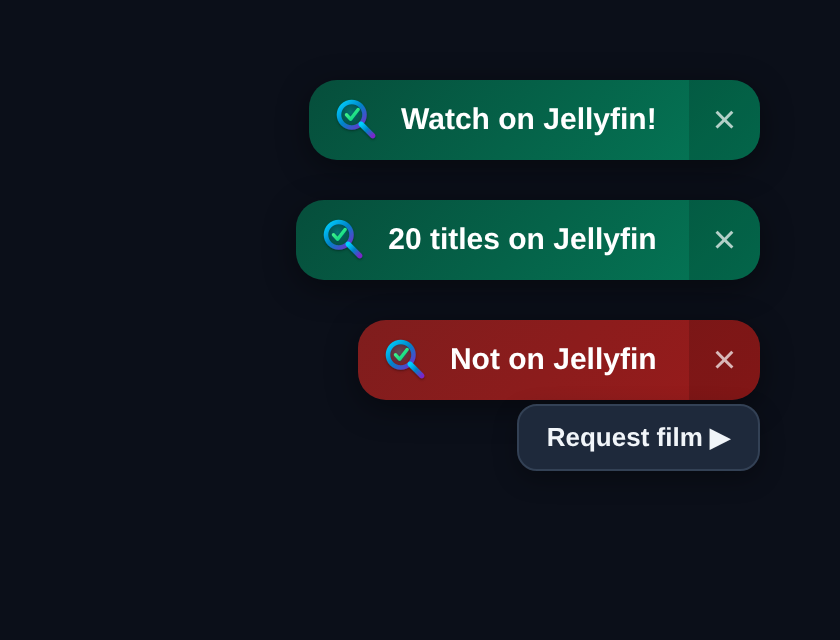
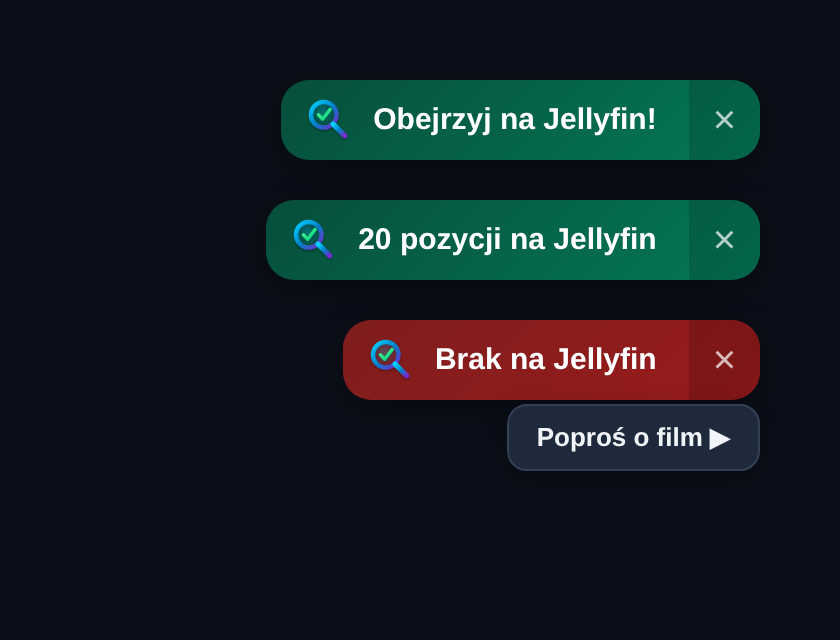

[ 🇬🇧 English ](#-english) • [ 🇵🇱 Polski ](#-polski)

# Jellyfin Checker

> See what is already in your Jellyfin library while browsing Filmweb, IMDb and TMDb.
>
> Sprawdź, co masz już w Jellyfinie, podczas przeglądania Filmwebu, IMDb i TMDb.

## 🇬🇧 English

Jellyfin Checker adds a library status badge to movie, series and person pages. If a title is available, click the badge to open it in Jellyfin. On a person page, it shows matching items from your library.

### Install and connect

You need a **Jellyfin server** you can reach from your browser and a **Jellyfin API key**.

1. Install from the [Chrome Web Store](https://chromewebstore.google.com/detail/jellyfin-checker/llbfpbeiiidailfdcbdeilmonlikdoef) in Chrome, Brave or Edge.
2. Click the extension icon and enter your Jellyfin URL, e.g. `http://192.168.1.100:8096`.
3. Add an API key created in your Jellyfin dashboard under **API Keys**. You need access to the server administration to create one.
4. Click **Test Connection**, then open a film page on Filmweb, IMDb or TMDb.

Settings save as you type. You can add a second Jellyfin URL as a fallback, for example a remote address.



### Using the extension

- A found title links to Jellyfin. A missing title means no match was found; a connection warning means the server could not be checked.
- Configure sound, Telegram requests and the light/dark/system theme in the popup.
- Filmweb series season pages check the parent series. Episode pages, news, rankings and discussions are excluded.
- Prefer a userscript? See [the userscripts guide](userscripts/README.md).

### Telegram requests (optional)

Let household members request a missing title from the page they are browsing.

1. Create a bot with [@BotFather](https://t.me/BotFather) and get your chat ID, e.g. with [@userinfobot](https://t.me/userinfobot).
2. In the popup, open **Options & Telegram** and enter the bot token and chat ID.
3. Enable the request button and click **Test Telegram**.

The request sends the title and source link to your configured Telegram chat. No separate request server is needed.

### Privacy and permissions

Settings and credentials are stored in `chrome.storage.local`. There is no analytics or telemetry sent to me. The extension sends title metadata to your Jellyfin server, uses Filmweb’s metadata API on Filmweb pages and contacts Telegram when you send a request or test message.

It requests broad HTTP/HTTPS host permissions because a Jellyfin server can use a local IP, `localhost` or a custom domain. Page scripts run on the supported film sites.

Firefox declares authentication information, website content and browsing activity in its installation consent. These categories describe credentials, title metadata and source links sent to the services you configure. See [Mozilla’s explanation](https://extensionworkshop.com/documentation/develop/firefox-builtin-data-consent/).

### Troubleshooting

| Problem | What to check |
| :--- | :--- |
| Connection warning | Test the server URL and API key in the popup. Make sure the server is reachable from this device. |
| A title is missing even though you have it | Search uses titles, then validates IMDb/TMDb IDs among the results. Different titles or missing provider IDs can affect matching. |
| No badge | Open a supported movie, series or person page. Filmweb episode and discussion pages are excluded. |
| Telegram test fails | Check the bot token, chat ID and whether the bot can send messages to that chat. |

<details>
<summary>Manual installation and Firefox testing</summary>

Clone the repository and build for your browser:

```bash
git clone https://github.com/patientone-io/jellyfin-checker.git
cd jellyfin-checker
bash build.sh chrome
# Or: bash build.sh firefox
```

- **Chrome / Brave / Edge:** open your extensions page (`chrome://extensions`, `brave://extensions` or `edge://extensions`), enable developer mode, choose **Load unpacked** and select `dist/chrome`.
- **Firefox 140+:** build with `bash build.sh firefox`, open `about:debugging#/runtime/this-firefox`, choose **Load Temporary Add-on** and select `dist/firefox/manifest.json`. This installation lasts until Firefox restarts. See [Mozilla’s temporary installation guide](https://extensionworkshop.com/documentation/develop/temporary-installation-in-firefox/).

The local extension and checker userscript are version `1.0.3`. The Filmweb linker is versioned separately at `1.4.0`. These are source versions; the store may offer an earlier release.

Run the regression checks with Node.js 18+:

```bash
node tests/regression.test.cjs
```

</details>

<details>
<summary>Search details and preconfigured installations</summary>

The extension searches up to 30 movie/series candidates by title. It prefers matching IMDb or TMDb IDs within those results, then tries approximate title matching with a year tolerance of two years and an original-title fallback. Person pages search library items by the person’s name. IDs are not queried independently, so a title outside the candidate results can be missed.

For fresh installations, you can pre-fill `src/config.json` before building. It is loaded only on first installation; updates preserve existing settings. A preconfigured package contains readable credentials. Do not publish it or share it beyond the intended users.

</details>

## 🇵🇱 Polski

Jellyfin Checker dodaje status biblioteki do stron filmów, seriali i osób. Jeśli masz dany tytuł, kliknięcie statusu otworzy go w Jellyfinie. Na stronie osoby zobaczysz pasujące pozycje ze swojej biblioteki.

### Instalacja i połączenie

Potrzebujesz **serwera Jellyfin** dostępnego z przeglądarki oraz **klucza API Jellyfina**.

1. Zainstaluj rozszerzenie z [Chrome Web Store](https://chromewebstore.google.com/detail/jellyfin-checker/llbfpbeiiidailfdcbdeilmonlikdoef) w Chrome, Brave lub Edge.
2. Kliknij ikonę rozszerzenia i wpisz adres Jellyfina, np. `http://192.168.1.100:8096`.
3. Dodaj klucz API utworzony w panelu administracyjnym Jellyfina, w sekcji **Klucze API**. Do jego utworzenia potrzebujesz dostępu do administracji serwera.
4. Kliknij **Test połączenia**, a potem otwórz stronę filmu na Filmwebie, IMDb lub TMDb.

Ustawienia zapisują się podczas pisania. Możesz dodać drugi adres Jellyfina jako zapasowy, np. adres zdalny.



### Korzystanie z rozszerzenia

- Znaleziony tytuł prowadzi do Jellyfina. Brak tytułu oznacza, że nie znaleziono dopasowania; ostrzeżenie o połączeniu oznacza, że nie udało się sprawdzić serwera.
- Dźwięk, prośby przez Telegrama i motyw jasny/ciemny/systemowy ustawisz w popupie.
- Strony sezonów na Filmwebie sprawdzają dostępność całego serialu. Strony odcinków, aktualności, rankingi i dyskusje są pomijane.
- Wolisz userscript? Zajrzyj do [instrukcji skryptów](userscripts/README.md).

### Prośby przez Telegrama (opcjonalnie)

Domownicy mogą poprosić o brakujący tytuł bezpośrednio ze strony, którą przeglądają.

1. Utwórz bota przez [@BotFather](https://t.me/BotFather) i poznaj ID swojego czatu, np. przez [@userinfobot](https://t.me/userinfobot).
2. W popupie otwórz **Opcje & Telegram** i wpisz token bota oraz ID czatu.
3. Włącz przycisk prośby i kliknij **Test Telegram**.

Prośba wysyła tytuł i link do skonfigurowanego czatu Telegram. Nie potrzebujesz osobnego serwera do obsługi próśb.

### Prywatność i uprawnienia

Ustawienia i klucze są przechowywane w `chrome.storage.local`. Rozszerzenie nie wysyła do mnie analityki ani telemetrii. Przekazuje metadane tytułów do Twojego Jellyfina, korzysta z API metadanych Filmwebu na jego stronach i łączy się z Telegramem po wysłaniu prośby lub wiadomości testowej.

Szerokie uprawnienia HTTP/HTTPS pozwalają łączyć się z Jellyfinem pod lokalnym IP, adresem `localhost` lub własną domeną. Skrypty stron działają na obsługiwanych serwisach filmowych.

Firefox deklaruje przy instalacji przesyłanie danych uwierzytelniających, treści stron i aktywności przeglądania. Kategorie opisują klucze, metadane tytułów i linki wysyłane do skonfigurowanych usług. Szczegóły w [dokumentacji Mozilli](https://extensionworkshop.com/documentation/develop/firefox-builtin-data-consent/).

### Rozwiązywanie problemów

| Problem | Co sprawdzić |
| :--- | :--- |
| Ostrzeżenie o połączeniu | Przetestuj adres i klucz API w popupie. Sprawdź dostępność serwera z tego urządzenia. |
| Masz film, ale rozszerzenie go nie znajduje | Wyszukiwanie zaczyna od tytułu, a potem sprawdza ID IMDb/TMDb w wynikach. Inny tytuł lub brak identyfikatorów może utrudnić dopasowanie. |
| Nie ma statusu | Otwórz obsługiwaną stronę filmu, serialu lub osoby. Odcinki i dyskusje na Filmwebie są pomijane. |
| Test Telegrama nie działa | Sprawdź token, ID czatu i możliwość wysyłania wiadomości przez bota na ten czat. |

<details>
<summary>Instalacja ręczna i testowanie w Firefoksie</summary>

Sklonuj repozytorium i zbuduj wersję dla swojej przeglądarki:

```bash
git clone https://github.com/patientone-io/jellyfin-checker.git
cd jellyfin-checker
bash build.sh chrome
# Albo: bash build.sh firefox
```

- **Chrome / Brave / Edge:** otwórz stronę rozszerzeń (`chrome://extensions`, `brave://extensions` lub `edge://extensions`), włącz tryb programisty, wybierz **Wczytaj rozpakowane** i wskaż `dist/chrome`.
- **Firefox 140+:** zbuduj wersję przez `bash build.sh firefox`, otwórz `about:debugging#/runtime/this-firefox`, wybierz **Wczytaj tymczasowy dodatek** i wskaż `dist/firefox/manifest.json`. Instalacja działa do restartu Firefoksa. Zobacz [instrukcję Mozilli](https://extensionworkshop.com/documentation/develop/temporary-installation-in-firefox/).

Lokalne rozszerzenie i userscript Checkera mają wersję `1.0.3`. Linker Filmwebu jest wersjonowany osobno, obecnie `1.4.0`. To wersje kodu w repozytorium; sklep może udostępniać wcześniejsze wydanie.

Testy regresji uruchomisz z Node.js 18+:

```bash
node tests/regression.test.cjs
```

</details>

<details>
<summary>Szczegóły wyszukiwania i konfiguracja dla domowników</summary>

Rozszerzenie wyszukuje po tytule maksymalnie 30 filmów i seriali. Wśród wyników preferuje zgodne ID IMDb lub TMDb, potem próbuje dopasowania przybliżonego z tolerancją dwóch lat i wyszukiwania po tytule oryginalnym. Strony osób wyszukują pozycje biblioteki po nazwisku. Identyfikatory nie są wyszukiwane niezależnie, więc tytuł spoza zwróconych wyników może zostać pominięty.

Przed przygotowaniem paczki do nowej instalacji możesz uzupełnić `src/config.json`. Jest wczytywany tylko przy pierwszej instalacji; aktualizacje zachowują ustawienia. Taka paczka zawiera klucze możliwe do odczytania. Nie publikuj jej i udostępniaj ją wyłącznie docelowym użytkownikom.

</details>

## 👤 Author & Contact / Autor i kontakt

[patientone](https://github.com/patientone-io) • [patientone.uk](https://patientone.uk) • [contact@patientone.uk](mailto:contact@patientone.uk)

Ideas and bug reports: open an issue in this repository. Include the steps to reproduce and your setup; remove API keys and tokens from logs.

Pomysły i błędy zgłoś w Issues tego repozytorium. Podaj kroki odtworzenia i swoją konfigurację; usuń klucze API i tokeny z logów.

## 📄 License / Licencja

- **EN:** [MIT License](LICENSE).
- **PL:** [Licencja MIT](LICENSE).
